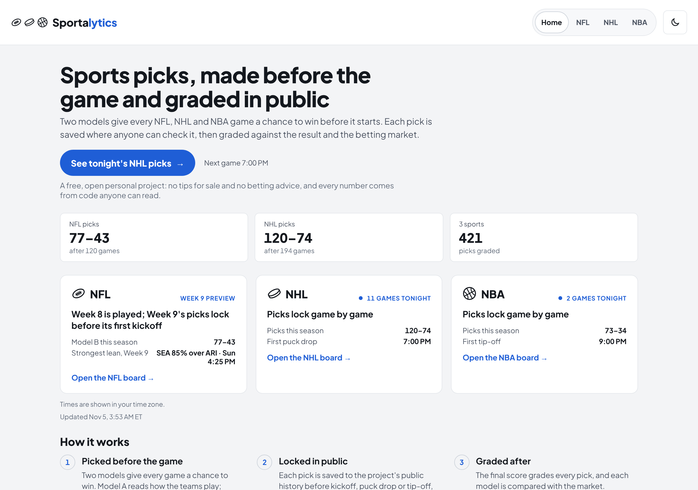
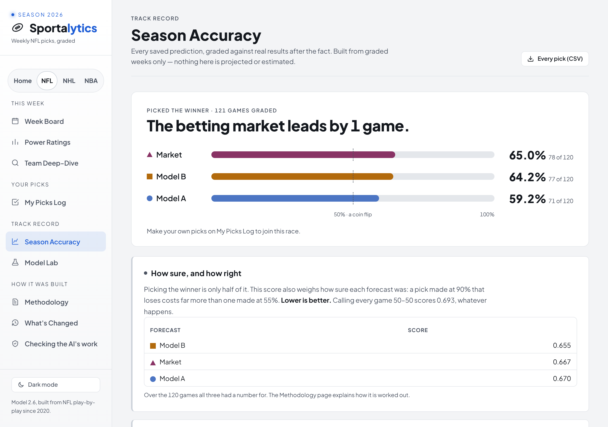
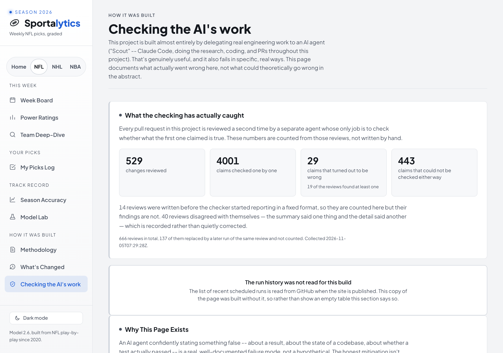

# Sportalytics

Backtested win-probability picks for the NFL (weekly), the NHL and the NBA
(daily), each saved before the game and graded in public. Not heuristics:
every model was registered, tuned and confirmed on held-out seasons before
it picked a live game, and the backtest numbers were actually run.

**Live site: https://lifeisgreat07.github.io/NFL-Model-2/** (a home page with
a card per sport; the boards are at [nfl/](https://lifeisgreat07.github.io/NFL-Model-2/nfl/),
[nhl/](https://lifeisgreat07.github.io/NFL-Model-2/nhl/) and
[nba/](https://lifeisgreat07.github.io/NFL-Model-2/nba/)).



*Screenshots in this README were taken on 2026-11-05 from the committed data, in the
light theme at 1280 px (shown at twice the pixels). The live pages load team logos from ESPN, which these
images leave out.*

## Results at a glance

Each sport's Model B (the model that also reads the betting market) against
the market itself and the base rate, in the backtest it was confirmed on and
live since its first saved pick.

<!-- glance:start -->
| Sport | Record | Model B | Market | Base rate |
|---|---|---|---|---|
| NFL | Backtest, 2022-2025 seasons | 0.6062 (1,087) | 0.6074 (1,087) | not published |
| NFL | Live 2026, weeks 1-8 | 0.6553 (120) | 0.6668 (120) | not published |
| NHL | Backtest, 2024-25 and 2025-26 | 0.6711 (2,624) | 0.6700 (2,624) | 0.6896 (2,792) |
| NHL | Live 2026-27, through 2026-11-03 | 0.6447 (174) | 0.6523 (174) | 0.6858 (194) |
| NBA | Backtest, 2024-25 and 2025-26 | 0.5820 (2,643) | 0.5812 (2,643) | 0.6888 (2,643) |
| NBA | Live 2026-27, through 2026-11-02 | 0.5680 (107) | 0.5681 (107) | 0.6982 (107) |

Log loss, lower is better, with the games each forecaster was scored on in brackets: a model or the market is scored only on the games it had a number for. The base rate is the home side's share of wins in every earlier game of the sport's history; the NFL's backtest and live record publish none. The live rows are as of the week or day they name, and recomputed from the saved picks by `tests/test_results_glance.py`; each sport's page has today's.
<!-- glance:end -->

## Run it in three commands

With Python 3.11, from the repository root:

```bash
pip install -r requirements.txt
python -m src.site.build --out _site
python -m http.server 8000 --directory _site
```

Then open http://localhost:8000. The build reads only the data committed here,
so it needs no network. Tests, the scheduled jobs and every other command are
in [docs/operations.md](docs/operations.md).

## What it demonstrates

- **Models that are judged against their baselines, including where they lose.**
  Each sport's backtest predicts every game from a model trained only on games
  played before it, refit every week as the live system is,
  and the table above sets every model against the betting market and the base
  rate. The models do not beat the market, and the record says so.
- **Picks that cannot be changed after the fact.** Every pick is committed
  before its game starts and graded after; the repository's history is the
  proof, and a test reads it back for every NHL and NBA pick.
- **Leak-free by construction, and tested for it.** A rating used for a game is
  computed only from games before it, and `tests/test_leak_free.py` fails the
  build if a later observation reaches an earlier prediction.
- **Experiments registered before they are run.** Each change to a model is
  written into a registry under `experiments/` with its question, metric,
  decision rule and seasons first, so a result cannot be reframed after it is
  seen. Rejected changes stay on the record, on each sport's Model Lab page.
- **A backtest that is re-run, not remembered.** The published figures are
  recomputed from the current code and checked to four decimals.
- **AI-assisted development with an independent verifier.** Four agents share
  the work, and the one that audits each change starts cold, cannot push, and
  re-runs every claim before it reports (below).
- **Tests that are themselves tested.** A committed mutation corpus
  (`tests/mutation/`, over 500 case files, one per subject under test) breaks
  the code in known ways and fails if the suite does not notice.
- **Thirty CI workflows** in `.github/workflows/` run the tests, the
  scheduled picks and grading, the audits of every pull request, the nightly
  canaries and checks, and the site's build; [docs/operations.md](docs/operations.md)
  says what to do when one of them opens an alert.
- **Case studies of what went wrong.** Five write-ups in `docs/case-studies/`,
  each a real problem, how it was found and what it cost, with every figure
  held to its source by a test.

## Current model (v2.6): the NFL

Opponent-adjusted team ratings from play-level EPA (a two-way ridge
regression, recency-weighted), a per-quarterback rating, and four features,
each a difference between the two teams: offence, defence, quarterback, and a
change of quarterback, fed to a logistic regression refit every week. **Model A**
is football only; **Model B** adds the betting spread. Live picks use the
quarterback expected to start. Every constant sits in
`src/sports/nfl/config.py` beside the backtest that chose it.

Backtest, 2022-2025, 1,087 games, refit every week on strictly earlier games,
which include the earlier weeks of the season being evaluated (the same table is on the NFL page's Methodology, and
`tests/test_readme_accuracy.py` fails if the two disagree):

| Model | Accuracy | Log Loss | Brier | AUC |
|---|---|---|---|---|
| Coin flip | 50.0% | 0.693 | 0.250 | 0.500 |
| Home team always wins | 54.6% | - | - | - |
| Model A (football only) | 62.7% | 0.650 | 0.229 | 0.670 |
| Vegas market alone | 68.2% | 0.607 | 0.210 | 0.725 |
| Model B (+ market) | 68.3% | 0.606 | 0.209 | 0.727 |

Judge it on log loss, Brier and AUC: accuracy can differ by a game or two
between machines, and Model B and the market are statistically tied.



The NHL's and NBA's models, their registries and backtests are on their own
pages: [nhl/](https://lifeisgreat07.github.io/NFL-Model-2/nhl/),
[nba/](https://lifeisgreat07.github.io/NFL-Model-2/nba/).

## How the work is checked

Most of this repository was written by an AI agent, and the setup around it
assumes the agent will sometimes be confidently wrong. Four agents share the
work:

<!-- agents:start -->
| Agent | What it does | When | Its record |
|---|---|---|---|
| **Scout** | Does the work and opens every pull request; `src/agents/scout_preflight.py` checks the description against the repository first | Every pull request | Each pull request and its pre-flight check, on GitHub; not counted in a file |
| **Booth** | Starts cold, re-runs each claim in the description, read-only, and posts a machine-readable verdict | Every pull request, and every edit of its description | 518 pull requests audited, 3,936 claims checked, 29 discrepancies found in 19 pull requests, as of 2026-11-05 03:51:57 UTC (`data/agent_log.json`) |
| **Spotter** | Renders the pages a pull request changes, at phone and desktop widths, light and dark, and comments with the pictures and a reading | Pull requests that touch a page | Advisory: one comment per pull request, never a verdict; not counted |
| **Line Judge** | Checks what each scheduled run left behind, and an agent diagnoses a finding from the run's logs | After each NFL weekly update and weekend refresh and each NHL and NBA daily run | Counted each Monday in the issue "Line Judge weekly digest" |
<!-- agents:end -->

Booth runs on the workflow's own read-only token, so it cannot push or
merge, and the workflow fails if it posts no report. Every audit is public:
the NFL page's "Checking the AI's work" counts them live from
`data/agent_log.json`.



## Read next

- [docs/README.md](docs/README.md): where to start, by what you want to know.
- [docs/architecture.md](docs/architecture.md): the whole system on one diagram.
- [docs/decisions/](docs/decisions/README.md): the seven decisions the rest rests on, one page each.
- [docs/case-studies/](docs/case-studies/): real problems, how they were found and what they cost.
- [docs/operations.md](docs/operations.md): running it, the scheduled jobs, and what to do when an alert opens.
- [CHANGELOG.md](CHANGELOG.md): what changed, month by month.
- [VERIFICATION.md](VERIFICATION.md): the rule that no claim here is made without evidence that was run.

## Licence

The code and writing in this repository are under the MIT licence
([LICENSE](LICENSE)). It does not cover what the project reads from
elsewhere: nflverse's data, the team logos loaded from ESPN, and the
self-hosted Plus Jakarta Sans font (its own licence is
`assets/fonts/OFL.txt`) stay under their own terms.
